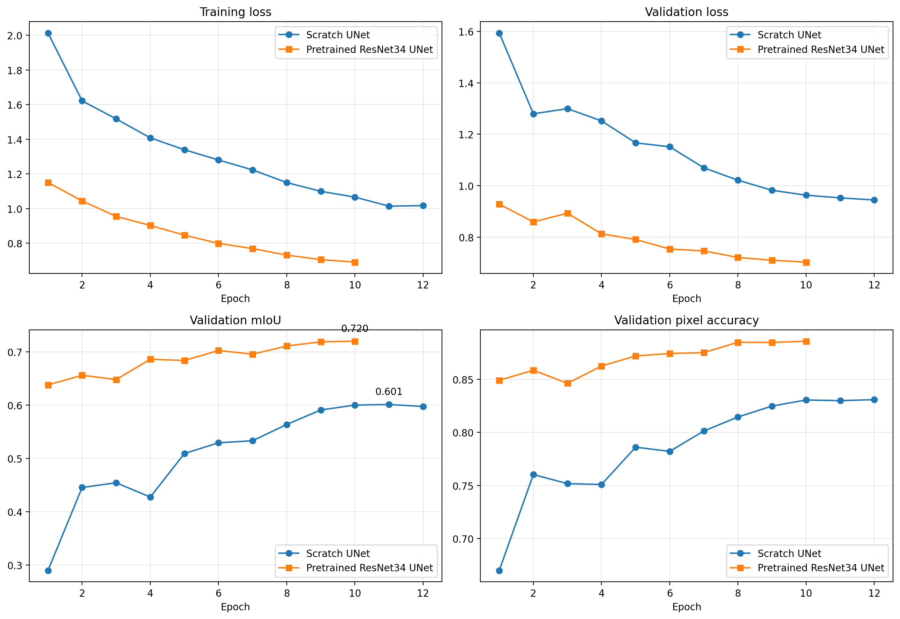
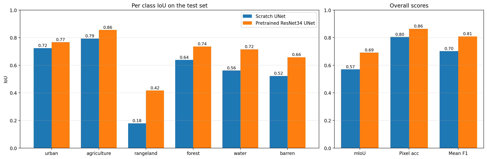
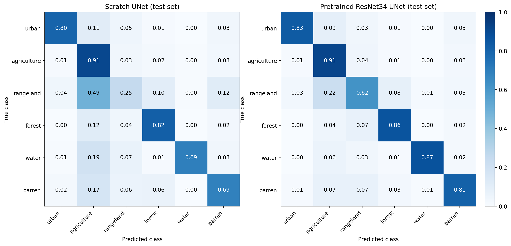
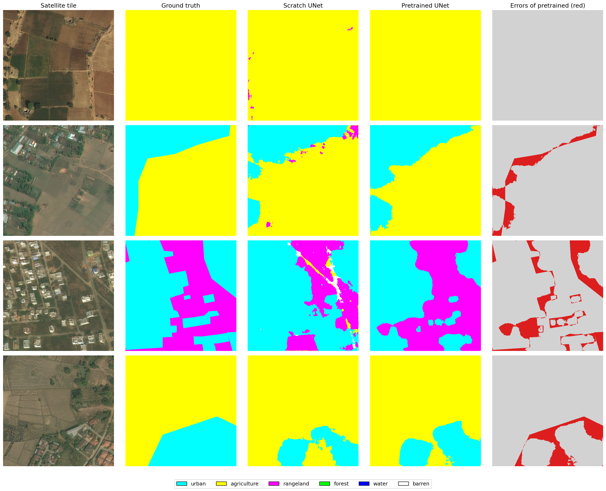

# Land Cover Segmentation: UNet from Scratch vs Pretrained ResNet34-UNet

Semantic segmentation of satellite imagery into 6 land cover classes
(urban, agriculture, rangeland, forest, water, barren), comparing a
UNet built from scratch against a UNet with a pretrained ResNet34
encoder (transfer learning), on the DeepGlobe Land Cover dataset.

## Project overview

Both models were trained on the same 512x512 tiles cut from the
DeepGlobe satellite images, using the same train/val/test split, the
same augmentations, and the same loss function (CrossEntropy + Dice).
The only real difference is the encoder: one is trained from random
weights, the other starts from ImageNet weights.

## Results (held-out test set, never used during training or model selection)

| Metric          | Scratch UNet | Pretrained ResNet34 UNet | Gain    |
|-----------------|-------------:|--------------------------:|--------:|
| mIoU            | 0.5698       | 0.6913                    | +0.1215 |
| Pixel accuracy  | 0.8050       | 0.8642                    | +0.0592 |
| Mean F1         | 0.7022       | 0.8089                    | +0.1068 |

### Per class IoU

| Class       | Scratch | Pretrained | Gain    |
|-------------|--------:|-----------:|--------:|
| Urban       | 0.7241  | 0.7669     | +0.0428 |
| Agriculture | 0.7933  | 0.8553     | +0.0620 |
| Rangeland   | 0.1789  | 0.4166     | +0.2377 |
| Forest      | 0.6384  | 0.7355     | +0.0971 |
| Water       | 0.5618  | 0.7154     | +0.1536 |
| Barren      | 0.5221  | 0.6578     | +0.1357 |

Rangeland was the hardest class for both models, since it visually
resembles agriculture in satellite imagery. Transfer learning gave
its largest gain on exactly this class (+0.24 IoU).

## Model details

| Model                    | Parameters | Inference (ms/batch of 8) |
|---------------------------|-----------:|----------------------------:|
| Scratch UNet               | 7.8M       | 94.7                         |
| Pretrained ResNet34 UNet   | 24.4M      | 67.0                         |

## Repository structure

- `notebook/`  full training and evaluation notebook
- `results/`  CSV files with per-class metrics on the test set
- `figures/`  training curves, confusion matrices, and prediction visualizations
- `split.json`  the exact train/val/test image ID split used

## Key visualizations

## Tools used

Python, PyTorch, segmentation-models-pytorch, OpenCV, pandas, matplotlib

## Author

Aamina Jadoon
[LinkedIn](https://linkedin.com/in/aamina-jadoon-13b36121b/) · [GitHub](https://github.com/Aamina04)